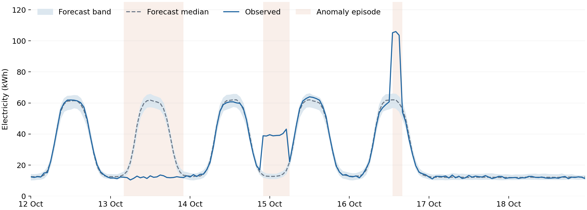

# Context-aware anomaly detection with Chronos-2 and Jev

This tutorial separates **anomaly detection** from **contextual interpretation**.
**Chronos-2** forecasts expected electricity consumption, Python flags deviations
outside its forecast band, and **Jev** interprets each episode using operational
records.

Open [context_aware_anomaly_triage.ipynb](context_aware_anomaly_triage.ipynb)
for the complete implementation and saved outputs. Follow one office building
through 12–18 October 2026, using the preceding eight weeks as forecasting
history. Meter readings and facility records are synthetic; forecasts and
decision responses are actual model outputs.



| Episode | Context | Jev's judgment |
|---|---|---|
| 13 October: missing daytime rise | Staff moved off-site and the office remained closed. | `LOG_EXPLAINED` |
| 14–15 October: elevated overnight consumption | The building was closed with no approved overnight activity. | `ALERT` |
| 16 October: afternoon surge | An electrical test matched the interval, but its location was unresolved. | `VERIFY_CONTEXT` |

## Run locally

Use Python 3.12 and an OpenRouter API key with access to Jev 1.14. Select an
existing environment with these dependencies, or create a fresh environment:

```powershell
py -3.12 -m venv .venv
```

For NVIDIA GPU inference, install CUDA-enabled PyTorch next, before installing
the remaining requirements. The recorded execution used PyTorch
2.11.0+cu128 on an NVIDIA RTX 2000 Ada laptop GPU. Its installation command is:

```powershell
.\.venv\Scripts\python.exe -m pip install torch==2.11.0 --index-url https://download.pytorch.org/whl/cu128
```

Then install the notebook dependencies and prepare the configuration:

```powershell
.\.venv\Scripts\python.exe -m pip install -r requirements.txt
if (-not (Test-Path .env)) { Copy-Item .env.example .env }
```

Set `OPENROUTER_API_KEY` in `.env`, select the prepared environment as the
notebook kernel, and run the cells in order. The notebook automatically uses
CUDA when available, otherwise CPU. The pinned Chronos-2 weights download on
first use if they are not cached. Running all cells makes one local forecast
and one paid Jev request per detected episode, then replaces the saved outputs.

## The meter fixture

`data/electricity.csv` contains 1,512 hourly measurements: eight weeks of
history and one monitoring week. The synthetic profile combines an essential
load of roughly 12 kWh per hour with plug, lighting, and ventilation loads that
follow smooth weekday occupancy, plus small daily and hourly variations.
During the monitoring week, occupancy on 13 October is removed, an extra
26 kWh per hour appears overnight on 14–15 October, and an extra 45 kWh per
hour appears for three hours on 16 October. These values were authored before
forecasting.

Only the preceding 1,344 meter readings enter Chronos-2. The CSV contains no
event labels. The separate `data/facility_notes.json` supplies the original
operational records to Jev. Its general triage question contains no examples
or fixture-specific rules. In an application, these records would be retrieved
from calendars, maintenance systems, or facility logs before calling Jev.

## Saved material

- [Results walkthrough](CASE_STUDY_RESULTS.md): the detected episodes and observed responses.
- `results/forecast.csv`: the complete 168-hour forecast.
- `results/monitoring_week.csv`: every measurement, forecast bound, and flag.
- `results/decisions.csv`: detected windows alongside selected actions.
- `results/triage_run.json`: exact Jev requests and complete native responses,
  plus model revisions and run settings. Authentication headers are omitted.
- `results/weekly_anomalies.png` and `.svg`: the continuous week.
- `results/episode_decisions.png` and `.svg`: close-ups with the selected actions.
- `results/jev_request_13_october.json`: the complete request used for the
  article's input example.
- `results/anomaly_detection_sequence.png` and `.svg`: the workflow diagram.
- `results/historical_consumption.png` and `.svg`: a view of the historical input.
- `results/jev_judgments_table.png`: the article's interpretation table.

## References

- [Chronos-2](https://huggingface.co/amazon/chronos-2)
- [Chronos forecasting library](https://github.com/amazon-science/chronos-forecasting)
- [OpenRouter Decisions API](https://openrouter.ai/docs/api/api-reference/alphadecisions/submit-a-decisions-request)
